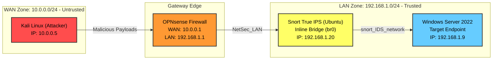

# Network Security Hardening Lab — Segmentation, Firewall Hardening & Inline IPS

A follow-up project to the <a href="https://github.com/Harisankar-01/SOC-Lab-Enterprise-Monitoring">SOC Lab project</a>, built specifically to close its biggest gap: the original SOC lab ran on a flat network where attacker to target traffic never touched the firewall. This project rebuilds the network with real segmentation, firewall rules to block malicious traffic, and an inline IDS/IPS that actively Detect, Alerts And blocks attacks.

**Environment:** VirtualBox, OPNsense Firewall,Snort IPS, Kali Linux, Windows Server 2022,

---

## Core Objective

The <a href="https://github.com/Harisankar-01/SOC-Lab-Enterprise-Monitoring">SOC Lab project</a>, demonstrated that weak network configuration, a flat subnet with no real firewall enforcement, let an attacker reach and brute-force a target directly.This project fixes that root cause: proper network segmentation forces all traffic through a firewall, hardened rules enforce default-deny, and an inline intrusion detection & prevention system actively alerts & drops malicious traffic in real time, rather than only alerts.

---

## Architecture
## Logical Network Architecture

This lab is segmented into an untrusted WAN zone and a trusted LAN zone, with traffic heavily filtered at the perimeter by OPNsense and physically inspected inline by a Snort IPS bridge.

All traffic between the attacker zone (WAN) and the protected zone (LAN) is forced through two layers: OPNsense's firewall, then a Snort VM running as a transparent inline bridge, inspecting and selectively dropping traffic based on custom and default signatures.

---

## Phase 1: Network Segmentation

- Replaced the SOC Lab's single flat subnet with two isolated VirtualBox Internal Networks: `NetSec_WAN` (10.0.0.0/24) and a `NetSec_LAN` segment (192.168.1.0/24)
- OPNsense configured with WAN (`10.0.0.1`) and LAN (`192.168.1.1`) interfaces, becoming the only path between zones
- Verified: Kali could reach its own gateway and nothing else until explicit rules were added, routing confirmed working end-to-end

**Result:** Kali-to-Windows-Server traffic, which bypassed the firewall entirely in the SOC Lab project, now physically must cross OPNsense.

---

## Phase 2: Firewall Hardening (Default-Deny)
`(OPNsense Firewall have its own inbuilt rules which blocks unwanted connections from untrusted zone by defualt)`
- Disabled broad "allow all" rules; configured explicit allow rules only for ICMP & SSH(testing) and RDP (TCP/3389)
- Verified default-deny is active: unallowed ports (e.g. via a full Nmap scan) return `not showed marked as closed OPNsesne detected and  blocked the request and logged the scan attempt as **"Default deny / state violation"**

**Result:** Nmap scan from Kali against Windows Server now shows only port 3389,22 are reachable; all other ports correctly filtered by the firewall, a direct contrast to the SOC Lab, where every port was reachable with no firewall visibility at all.

---

## Phase 3: Inline Intrusion Detection & Prevention using snort

Deployed a dedicated Ubuntu Server VM running Snort, specifically in **inline mode** (not passive/IDS-only like the SOC Lab's Suricata), so it can actively monitor and drop malicious traffic rather than just alert on it.

**Setup:**
- Two network adapters on the Snort VM, bridging OPNsense's LAN interface and Windows Server into one transparent inline path
- Ran Snort with the AFPACKET inline DAQ (`-Q --daq afpacket -i enp0s3:enp0s8`), allowing it to inspect and drop packets in the live traffic path
- Actual command ran to start snort :
  `sudo snort -c /etc/snort/snort.conf -Q --daq afpacket -i enp0s3:enp0s8 -A console`
  
**Custom detection rules to prevent — RDP brute force:**
  `drop tcp any any -> 192.168.1.9 3389 (msg:“RDP Brute Force Attempt Detected - BLOCKED”; flags:S; detection_filter:track by_src, count 5, seconds 60; sid:1000002; rev:1;)`

**Key troubleshooting finding:** the first version of this rule used `flow:to_server,established`, which matched every packet in an *already-open* session, including normal RDP use, and caused legitimate logins to be dropped as false positives. Fixed by matching only new connection attempts (`flags:S`, the initial SYN packet) rather than ongoing session traffic. This distinction, counting new connections vs. counting all session packets, is the difference between a usable IPS rule and one that blocks real users.

**Result — verified working:**
- Legitimate RDP login (`xfreerdp`) connects normally
- Brute-force attempt (`hydra` / `ncrack`) against the same port triggers the rule after 5 attempts within 60 seconds; Snort logs **"RDP Brute Force Attempt Detected - BLOCKED"**, and the attacking tool's subsequent connections fail to establish, direct evidence of real-time automated blocking, not just detection

**Additional finding:** Snort's default community ruleset independently flagged an Nmap scan under an "information leakage" classification (alert-only, not yet configured to drop), confirming out-of-the-box signatures add detection coverage beyond custom rules alone.

---

## Before vs. After Comparison

| | SOC Lab (Original) | Network Security Lab (This Project) |
|---|---|---|
| Network | Flat subnet, no segmentation | WAN/LAN segmented via OPNsense |
| Attacker-to-target traffic | Bypassed firewall entirely | Forced through firewall + IPS |
| Nmap scan result | All ports open/reachable | Only explicitly allowed ports reachable |
| Brute force outcome | Succeeded, only logged after the fact (Suricata/Wazuh, alert-only) | Actively blocked in real time by inline Snort |
| Detection type | Passive IDS (alert-only) | Inline IPS (detect + drop) |

---

## Key Takeaways

Segmentation and firewall rules alone control *which* services are reachable, but they don't protect a service that's intentionally allowed through, RDP being open for legitimate use still left it exploitable by brute force. Closing that gap required a true inline IPS capable of recognizing and actively dropping the attack pattern in real time, not just logging it. This project also reinforced that naive detection rules can create false positives if they don't distinguish between "new connection attempt" and "ongoing legitimate session", a distinction that matters as much in production environments as it did here.

---

## Evidence

Screenshots and logs (firewall rule configuration, live-view logs showing blocked/passed traffic, Snort console output for both the brute-force block and the Nmap detection) are in [`screenshots/`](screenshots/).

