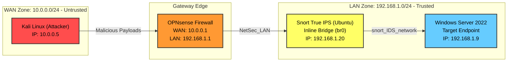

# Network Security Hardening Lab — Segmentation, Firewall Hardening & Inline IPS

A follow-up project to the <a href="https://github.com/Harisankar-01/SOC-Lab-Enterprise-Monitoring">SOC Lab project</a>, built specifically to close its biggest gap: the original SOC lab ran on a flat network where attacker to target traffic never touched the firewall. This project rebuilds the network with real segmentation, firewall rules to block malicious traffic, and an inline IDS/IPS that actively Detect, Alerts And blocks attacks.

**Environment:** VirtualBox, OPNsense Firewall,Snort IPS, Kali Linux, Windows Server 2022, Windows 7

---

## Core Objective

The <a href="https://github.com/Harisankar-01/SOC-Lab-Enterprise-Monitoring">SOC Lab project</a>, demonstrated that weak network configuration, a flat subnet with no real firewall enforcement, let an attacker reach and brute-force a target directly.This project fixes that root cause: proper network segmentation forces all traffic through a firewall, hardened rules enforce default-deny, and an inline intrusion detection & prevention system actively alerts & drops malicious traffic in real time, rather than only alerts.

---

## Architecture
## Logical Network Architecture

This lab is segmented into an untrusted WAN zone and a trusted LAN zone, with traffic heavily filtered at the perimeter by OPNsense and physically inspected inline by a Snort IPS bridge.

